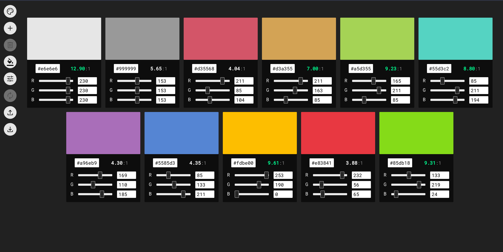

# Chromaplay

A color palette experimentation tool.

<https://zooce.github.io/chromaplay>



## Setup

Install [mise](https://mise.jdx.dev/getting-started.html), then:

```bash
mise trust
mise install
mise run dev
```

`mise run build` writes the production site to `dist`. `mise run serve` previews that build.
